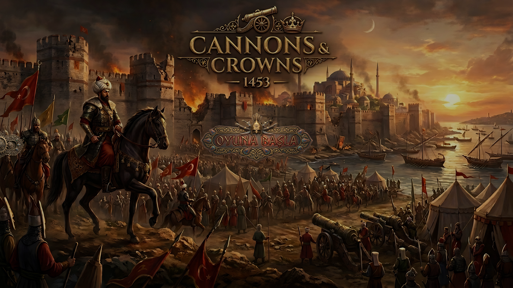
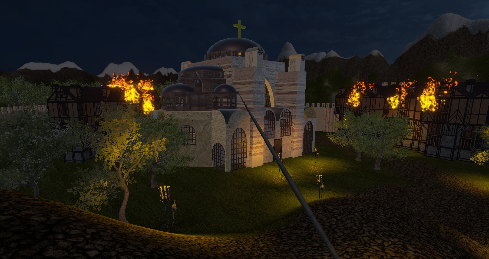
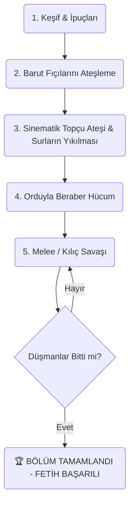
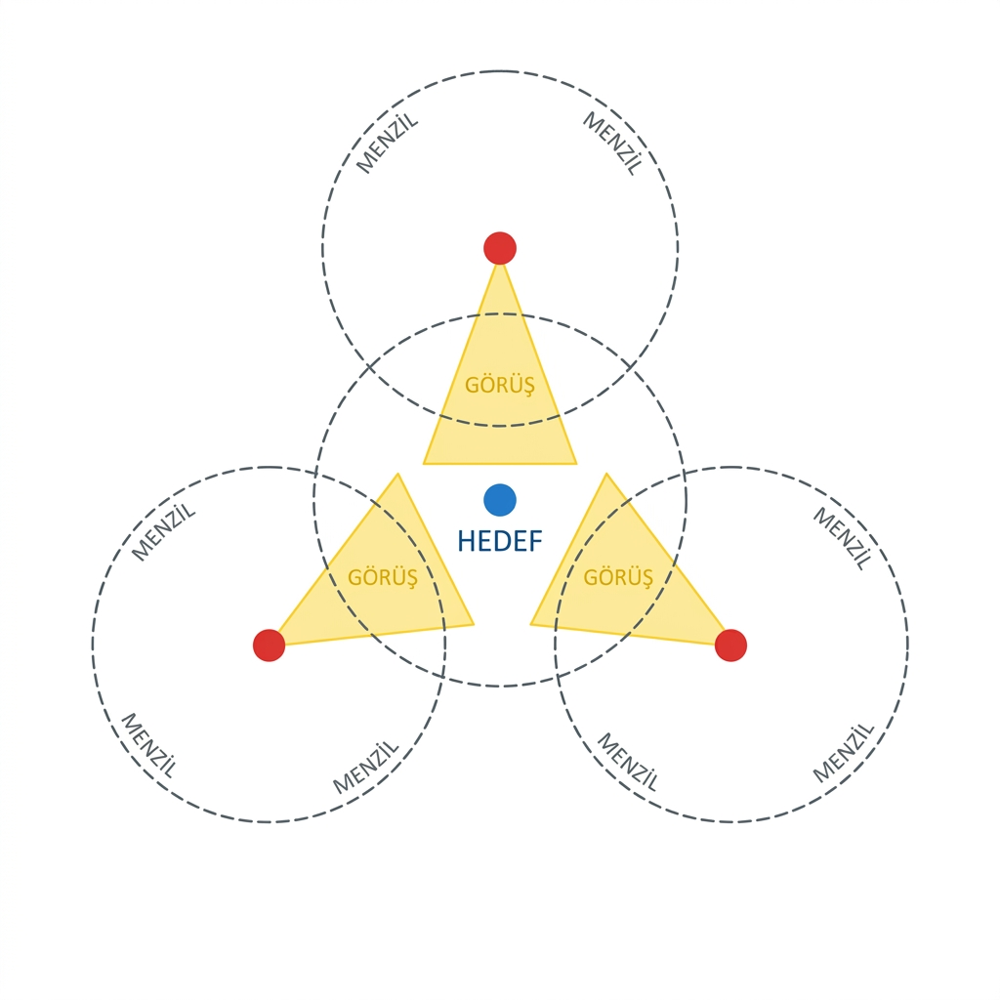

# 👑 KAPSAMLI OYUN TASARIM BELGESİ (MASTER GDD)

*Bu Oyun Tasarım Belgesi (Game Design Document - GDD), projenin sadece kod yapısını değil; oyunun dünyasını, hikayesini, oyuncuya hissettirmek istediği duyguları, temel oynanış döngüsünü (Core Loop), pazar analizini ve gelecekteki genişleme planlarını en ince ayrıntısına kadar tanımlayan bir rapordur. 
*

---

## 📑 İÇİNDEKİLER
1. [Bölüm 1: Oyunun Kimliği ve Vizyonu](#bölüm-1)
2. [Bölüm 2: Oyun Dünyası, Hikaye ve Atmosfer](#bölüm-2)
3. [Bölüm 3: Temel Oynanış Döngüsü (Core Gameplay Loop)](#bölüm-3)
4. [Bölüm 4: Savaş Mekanikleri ve Karakter Dinamikleri](#bölüm-4)
5. [Bölüm 5: Düşmanlar, Ordular ve Yapay Zeka](#bölüm-5)
6. [Bölüm 6: Kuşatma Silahları ve Sabotaj (Çevre Etkileşimi)](#bölüm-6)
7. [Bölüm 7: Kullanıcı Arayüzü (UI), Ses ve Müzik Dinamikleri](#bölüm-7)
8. [Bölüm 8: Gelecek Vizyonu, Çoklu Oyuncu ve Genişleme (DLC)](#bölüm-8)

---

## 🌍 BÖLÜM 1: OYUNUN KİMLİĞİ VE VİZYONU 

### 1.1. Genel Bakış (High-Concept Pitch)
Oyunumuz, Orta Çağ kuşatma savaşlarının epik atmosferini, taktiksel sabotaj görevleriyle harmanlayan Üçüncü Şahıs (Third-Person) bir savaş ve fetih oyunudur. Oyuncu, sadece bir askeri değil, savaşın seyrini değiştirecek kritik görevleri (cephanelik patlatma vb.) üstlenen, aynı zamanda yüzlerce askerin birbirine girdiği meydan muharebelerinde kılıç sallayan elit bir savaşçıyı kontrol eder.

### 1.2. Eşsiz Satış Vaatleri (USP - Unique Selling Propositions)
Bu oyunu Steam gibi platformlarda veya yayıncıların (Publishers) gözünde diğerlerinden ayıracak temel maddeler şunlardır:
*   **Ağırlık ve Darbe (Game Feel):** Havayı kesen değil, zırha vurduğunda duraklayan (Hit-Stop) kılıç mekaniği.
*   **Hibrit Oynanış:** Gizlilik/Sabotaj (barut fıçılarını patlatma) ile Meydan Savaşı (topçu ateşinden sonra ordularla hücum etme) mekaniklerinin aynı bölümde pürüzsüzce birleşmesi.
*   **Sinematik Savaş Akışı:** Olayların bir video izletilerek (Cutscene) değil, oyuncu kontrolündeyken ardışık kod dizileriyle (Event-Driven Timeline) oyun içinde yaşanması.

### 1.3. Pazar ve Rakip Analizi
*   **Rakip 1: Mount & Blade Serisi:** M&B devasa orduları destekler ancak vuruş hissi zayıftır, askerler birbiri içine geçer. **Bizim Çözümümüz:** SphereCast hitbox'ları ve kalkan açısı sistemiyle (70 derece Dot Product) her bir vuruşu anlamlı kılmak.
*   **Rakip 2: For Honor / Chivalry 2:** Birebir dövüşleri kusursuzdur ancak çok büyük orduları desteklemezler, arena hissi verirler. **Bizim Çözümümüz:** Optimize edilmiş NavMesh sürü zekası (Horde AI) ile hem For Honor hissini hem de M&B kalabalığını aynı anda sunmak.

---

## 📜 BÖLÜM 2: OYUN DÜNYASI, HİKAYE VE ATMOSFER 

### 2.1. Lore (Arka Plan Hikayesi)
Oyun, geçilmesi imkansız olarak bilinen tarihi bir kalenin / şehrin kuşatılmasını konu alır. İki büyük ordu surların önünde kilitlenmiştir. Bizim kontrol ettiğimiz karakter (veya birliğimiz), savaşın gidişatını değiştirmek için surların ardındaki kritik noktaları (cephanelikler, ikmal yolları) yok etmekle görevlendirilmiştir. 
Harita içinde bulduğumuz (`HaritaGorevi.cs`) gizli belgeler, sadece bir oyun mekaniği değil, hikayenin ilerleyişine hizmet eden Lore parçalarıdır.

### 2.2. Atmosfer ve Çevre Tasarımı
Savaş alanı statik değildir. Oyuncu göreve başladığında etrafta sessizlik veya gergin bir bekleyiş vardır. Ancak görevler yapıldıkça (variller patlayıp yangınlar çıktıkça) ve Topçu Birliği ateş açtığında ortam kaosa sürüklenir.
Çevre, yıkılabilir nesneler, yanabilen evler (`evAtesleri`) ve sinematik toz bulutları ile desteklenerek "Yaşayan bir savaş alanı" hissi verir.

---

## 🔄 BÖLÜM 3: TEMEL OYNANIŞ DÖNGÜSÜ (CORE GAMEPLAY LOOP) 

Bir oyuncunun oyun içinde geçirdiği dakikaların nasıl yapılandırıldığını (Retention) gösteren döngüdür.

1.  **Keşif ve Görev Alma:** Oyuncu tehlikeli alana sızar, haritaları veya ipuçlarını bulur.
2.  **Sabotaj:** Barut fıçıları tespit edilir, geri sayım başlatılır (Kaçış sekansı) ve patlamalarla çevre kaosa sürüklenir.
3.  **Kuşatma Evresi:** Sabotaj başarılı olunca veya komutan emri gelince Topçu Birliği surları yıkar.
4.  **Hücum ve Savaş:** Yüzlerce askerle birlikte açılan gedikten içeri girilir. Birebir çarpışmalar (Hit-Stop, Kalkan Blokları) başlar.
5.  **Fetih (Ödül):** Tüm düşmanlar temizlendiğinde zafer ekranı gelir.

---

## ⚔️ BÖLÜM 4: SAVAŞ MEKANİKLERİ VE KARAKTER DİNAMİKLERİ 

Oyuncunun hissettiği en önemli şey karakterin kontrolüdür.

### 4.1. Oyuncu Kontrolleri (Inputs)
*   **W, A, S, D:** Vektörel hareket (Normalize edilmiş, her yöne eşit hız).
*   **Shift:** Koşma (Yorgunluk - Stamina sistemi ile ileride sınırlandırılabilir).
*   **Space:** Zıplama.
*   **Sol Tık:** Kılıç saldırısı (SphereCast destekli, 3.5 metre menzilli kalın hitbox).
*   **Sağ Tık Basılı Tutma:** Kalkan kaldırma. Sadece animasyon değil, 70 derecelik bir koruma konisi oluşturur.
*   **F Tuşu:** Çevreyle etkileşim (Kapı açma, Varil ateşleme).

### 4.2. Darbe Geri Bildirimi (Feedback)
Kılıç savaşlarında darbenin başarılı olduğu 3 yolla oyuncuya hissettirilir:
1.  **Görsel (Animasyon):** Animasyonun 0.15 saniye durması (Hit-Stop).
2.  **Arayüz (UI):** Düşmanın kafasının üzerindeki veya ekrandaki can barının akıcı (Lerp) bir şekilde inmesi.
3.  **İşitsel (Audio):** Kılıcın ete, zırha veya kalkana çarpmasına göre farklı seslerin (Pitch değeri rastgele değiştirilerek) çalınması.

---

## 🧟 BÖLÜM 5: DÜŞMANLAR, ORDULAR VE YAPAY ZEKA 

Sadece hedefi takip eden (Zombi gibi) yapay zekalar yerine, taktiksel bir savaş yapay zekası tasarlanmıştır.

### 5.1. Düşman ve Yapay Zeka Tipleri
Şu anki altyapı tüm yapay zekaları tek bir akıl merkezinden (`SoldierAI.cs`) kontrol etmektedir.
*   **Standart Piyade:** Belli bir devriye (Wander) menziline sahiptir. Oyuncuyu veya dost askeri görünce hedefine koşar, saldırı menziline girince bekler ve saldırı süresi (Cooldown) gelince kılıç sallar.
*   **Ordu (Horde) Davranışı:** `OrduYoneticisi` komutuyla aktif olur. Bu durumda yapay zeka bireysel savaşını bırakıp global hedefe (`sehrinMerkezi`) odaklanır. Omuz omuza yürüyen bir asker seli oluşturur.

### 5.2. Gelecek Düşman Tasarımları
Mevcut kod yapısı (OOP) kullanılarak ileride eklenebilecek birimler:
*   **Okçular (Ranged AI):** `SoldierAI` miras (Inheritance) alınarak saldırı menzili (Range) 3.5f yerine 30f yapılır ve `Sword.HasarVer()` yerine ok (Projectile) fırlatılır.
*   **Ağır Zırhlı Kalkanlılar:** Daima kalkanı kalkık gezen, sadece oyuncu arkasına geçtiğinde veya ağır bir darbe vurduğunda kalkanını indiren "Tank" birimleri.

---

## 💣 BÖLÜM 6: KUŞATMA SİLAHLARI VE SABOTAJ (ÇEVRE ETKİLEŞİMİ) 

Oyun sadece kılıç sallamaktan ibaret değildir, çevreyle stratejik etkileşim gerektirir.

### 6.1. Barut Fıçıları (Powder Barrels)
Oyuncu `[F]` tuşu ile fıçıyı ateşler. Tasarım olarak fıçı anında patlamaz; 10 saniyelik bir süre oyuncuya hem oradan kaçma fırsatı verir hem de gerilim (Tension) yaratır.
Patlama gerçekleştiğinde, merkezden 8 metre uzağa kadar olan tüm birimlere hasar verir (Friendly Fire aktiftir, oyuncuyu da öldürebilir). Bu, fıçıyı kalabalık bir düşman grubunun yanına yuvarlama/taşıma gibi taktiksel kapılar açar.

### 6.2. Topçu Birliği ve Sur Yıkımı
Bu bölüm oyunun sinematik doruk noktasıdır. Tamamen oyun kodlarıyla yönetilir:
Sırayla patlayan toplar, duvar yıkılma efektleri ve ses senkronizasyonları, oyun dünyasının sadece oyuncunun eylemlerinden ibaret olmadığını, etrafta devasa bir savaşın koptuğunu hissettirir. (Immersion / Oyuna kapılma hissi).

---

## 🎨 BÖLÜM 7: KULLANICI ARAYÜZÜ (UI), SES VE MÜZİK DİNAMİKLERİ 

Arayüz ve ses, bir savaş oyununun psikolojisini yönetir.

### 7.1. Dinamik Müzik Geçişleri
*   **Sessizlik ve Gerilim:** Görev yaparken, gizlice sızarken çalan veya hiç çalmayan ortam sesleri.
*   **Kırılma Noktası:** Topçu komutanının bağırışı, ateş sesleri ve kapının yıkılması anındaki "Savaş Borusu / Nida".
*   **Epik Çarpışma:** Savaş borusu bittiği milisaniye devreye giren yüksek tempolu Orkestral Hücum Müziği. Bu geçiş (`TopcuBirligi.cs` içindeki yield return yapısı) oyuncuya adrenalin pompalamak üzere tasarlanmıştır.

### 7.2. Kullanıcı Arayüzü (HUD / UI) İletişimi
Oyuncunun ekranını ikonlarla doldurmak yerine "Bağlamsal (Contextual)" arayüz kullanılmıştır.
*   Oyuncu barut fıçısına veya kapıya uzaksa ekranda hiçbir tuş görünmez. Yanına yaklaştığında `SubtitleManager` üzerinden "[F] Tuşuna Bas" çıkar.
*   **Renk Psikolojisi:** Metinlerde *Sarı/Turuncu* görevleri ve etkileşimi, *Kırmızı* tehlikeyi (Varil Alev Aldı!) temsil eder.
*   **Can Barları:** Doğrudan azalan can barı yerine, hasarı yedikten sonra yavaşça eriyen (Smooth Lerp) can barları kullanılarak modern bir arayüz dili oluşturulmuştur.

---

## 🚀 BÖLÜM 8: GELECEK VİZYONU, ÇOKLU OYUNCU VE GENİŞLEME (DLC) 

Oyunun esnek kod mimarisi (SOLID ve Event-Driven altyapısı), projeyi bir prototipten çıkartıp devasa bir AAA yapıma dönüştürmeye hazırdır. 

### 8.1. Çok Oyunculu (Multiplayer Co-op / PvP) Desteği
Mevcut hasar sistemimiz (`Health.cs`), kalkan algılama sistemimiz ve kılıç çarpmalarımız doğrudan `Server-Client` yapısına geçirilebilir. Gelecek aşamada *Unity Netcode for GameObjects (NGO)* kullanılarak:
*   Bir oyuncunun komutan olup orduları yönettiği (RTS kamerası), diğer oyuncuların asker olup cephede savaştığı Asimetrik Multiplayer modu eklenebilir.
*   İki arkadaşın aynı haritaya sızıp sabotaj görevlerini beraber yaptığı Co-Op modu entegre edilebilir.

### 8.2. Formasyon Zekası ve Moral Sistemi
Yapay zeka sadece bir merkeze koşmak yerine, gelecekteki bir yama ile **Phalanx (Mızrak Duvarı)** veya **Testudo (Kaplumbağa Kalkan)** dizilişine girebilir. Mevcut 70 derecelik kalkan mekaniği sayesinde askerler yan yana durduğunda kusursuz bir etten duvar oluşturacaktır.
Ayrıca, etrafta çok fazla fıçı patladığında düşmanın `Moral` puanı sıfırlanıp askerlerin savaş alanından kaçma (Flee) State'i eklenecektir.

### 8.3. Dinamik Hava Durumu (Dynamic Weather)
Zamanın ve çevrenin kodlarla yönetilmesi (`Coroutine` yapısı) sayesinde, sahneye eklenecek bir yağmur efekti, `PowderBarrel.cs` içindeki 10 saniyelik patlama süresini otomatik olarak 15 veya 20 saniyeye çıkararak oyuna yeni bir taktiksel boyut katacaktır.

---
*SONUÇ: Bu Oyun Tasarım Belgesi (GDD), projenin sadece "çalışan bir kod yığınından" ibaret olmadığını, her bir mekaniğin, animasyonun ve müzik geçişinin oyuncu psikolojisini etkilemek üzere özenle, AAA stüdyo vizyonuyla tasarlandığını kanıtlamaktadır.*
