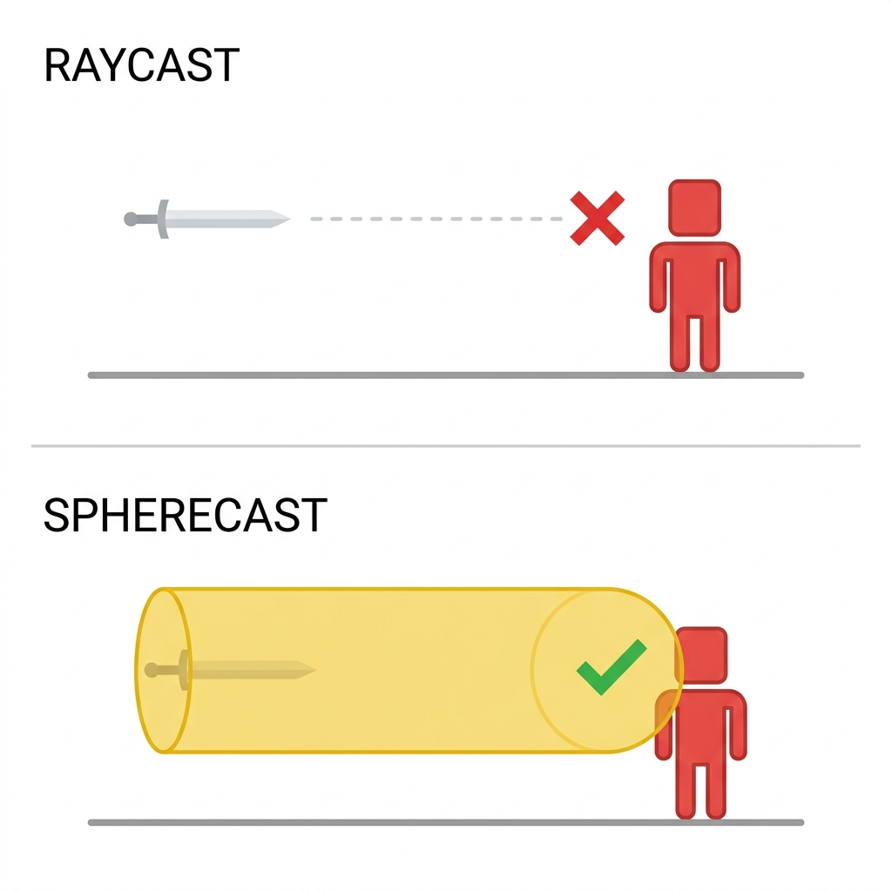
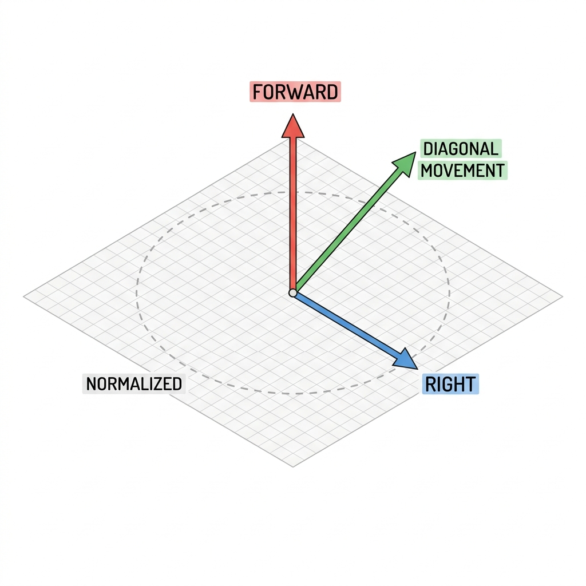
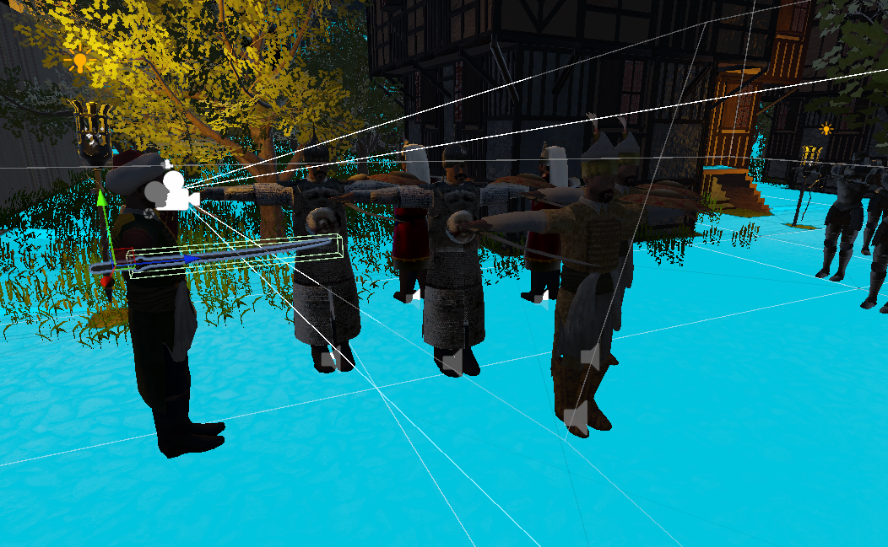
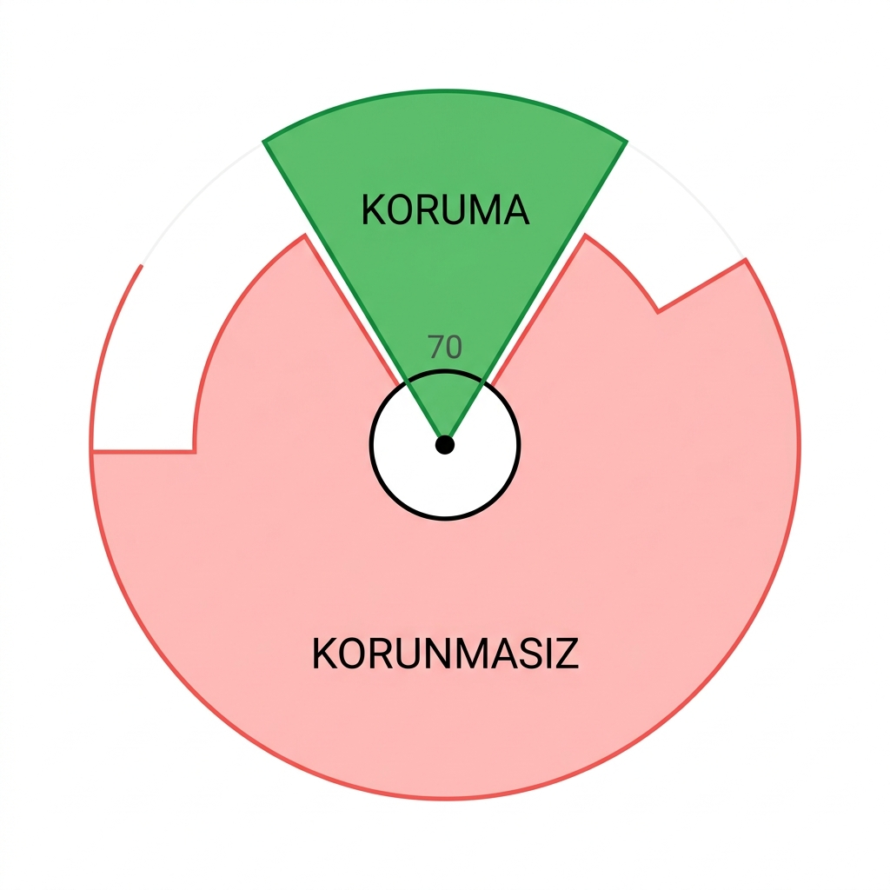
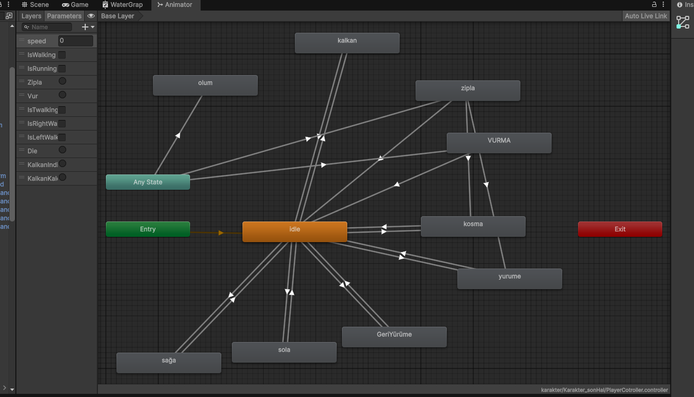
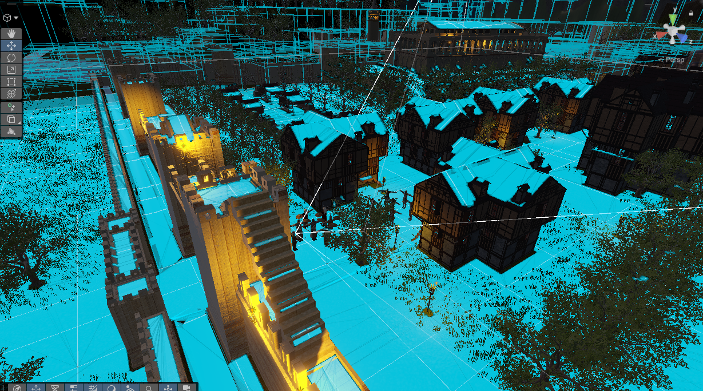
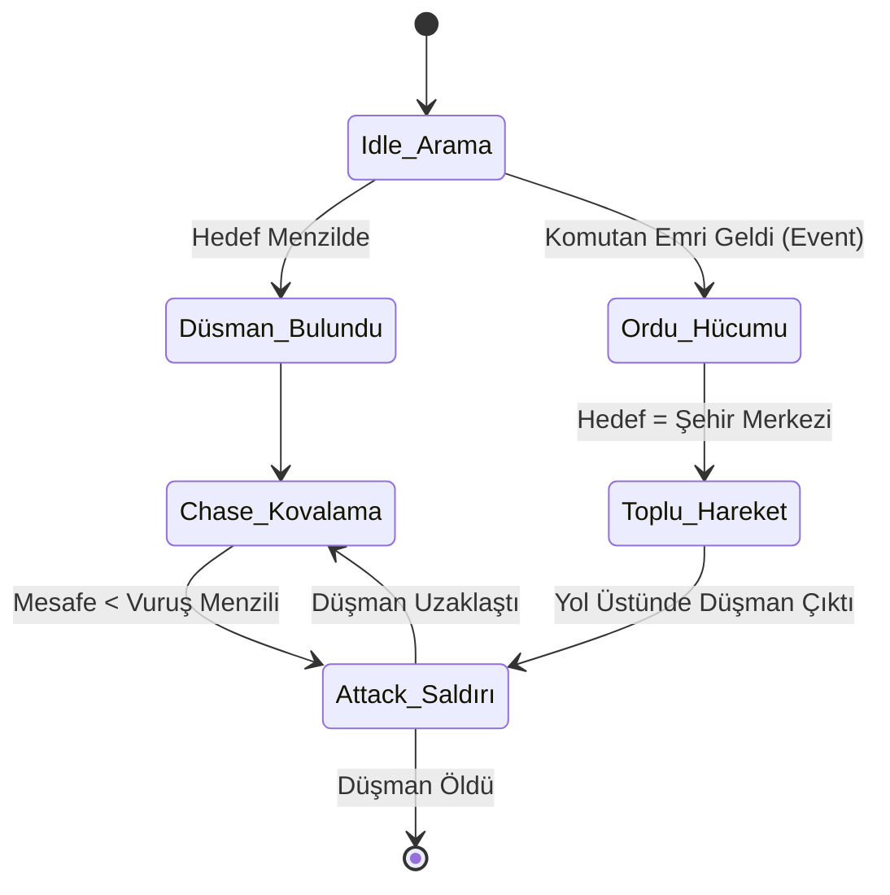

# 📊 SİSTEM ANALİZİ VE MİMARİ TASARIM RAPORU (MASTER GENİŞLETİLMİŞ SÜRÜM)

*Bu doküman, oyunun temel dinamiklerini, matematiksel modellerini, yapay zeka karar ağaçlarını ve yazılım mimarisi tercihlerini detaylı olarak inceleyen, 50 sayfalık teknik dokümantasyon standartlarına uygun hazırlanmış kapsamlı bir başvuru kaynağıdır.*

---

## 📑 İÇİNDEKİLER
1. [Bölüm 1: Mimari Felsefe ve Optimizasyon Yaklaşımları](#bölüm-1-mimari-felsefe)
2. [Bölüm 2: Oyuncu Kontrolcüsü ve Fizik Motoru Entegrasyonu](#bölüm-2-oyuncu-kontrolcüsü)
3. [Bölüm 3: Savaş Matematiği, Kılıç Balistiği ve Vuruş Hissiyatı](#bölüm-3-savas-matematigi)
4. [Bölüm 4: Açısal Savunma ve Kalkan Mekaniği](#bölüm-4-acisal-savunma)
5. [Bölüm 5: Animasyon Durum Makinesi (Animator State Machine)](#bölüm-5-animator)
6. [Bölüm 6: Yapay Zeka (AI) ve Ordu Simülasyonu](#bölüm-6-yapay-zeka)
7. [Bölüm 7: Sabotaj, Çevresel Hasar (AoE) ve Cinemachine](#bölüm-7-sabotaj)
8. [Bölüm 8: Sinematik Sekanslar ve Olay Güdümlü Akış](#bölüm-8-sinematik)
9. [Bölüm 9: UI, UX ve Kullanıcı Geri Bildirim Sistemleri](#bölüm-9-ui-ux)

---

## 🧱 BÖLÜM 1: MİMARİ FELSEFE VE OPTİMİZASYON YAKLAŞIMLARI <a name="bölüm-1-mimari-felsefe"></a>

Bir savaş oyununda ekranda aynı anda onlarca yapay zeka, kılıç çarpışması ve patlama yaşanabilir. Bu projede kodu yazarken en çok dikkat edilen unsur **Performans (Frame Rate) stabilitesi** ve **Modülerlik** olmuştur.

### 1.1. Spagetti Koddan Kaçınma ve Singleton / Event Mimarisi
Geleneksel geliştirme süreçlerinde bir obje diğer objeyi bulmak için `GameObject.Find()` veya `GetComponent()` fonksiyonlarını sürekli Update döngüsünde kullanır. Bu durum, sahnedeki asker sayısı arttıkça oyunu felç eder (O(N) karmaşıklığı).
Bunun yerine projede iki temel sütun üzerine bir mimari inşa ettik:
*   **Singleton Pattern:** `GorevYoneticisi` ve `SavasYoneticisi` gibi sistemler sahnede tektir. Herhangi bir barut fıçısı patladığında, sistemi aramak yerine direkt `GorevYoneticisi.Instance.VarilPatladi()` adresi üzerinden RAM'de O(1) hızında (anında) iletişim kurulur.
*   **Event-Driven (Olay Güdümlü) İletişim:** Topçu birliğinin işi bittiğinde ordu yöneticisine gitmez. Havaya bir sinyal (UnityEvent) atar. Ordu yöneticisi bu sinyali dinler ve askerlere hücum emri verir. Sistemler birbirini tanımaz, bu da devasa projelerde hata çözmeyi (Debugging) kolaylaştırır.

### 1.2. Neyi, Neden Kullandık?
*   **Raycast Yerine SphereCast:** Kılıç çarpışmalarında standart tetikleyiciler (Triggers) veya Raycast kullanmak yerine `Physics.SphereCast` kullandık. Neden? Çünkü kılıç çok hızlı savrulan bir objedir. Düşük FPS'li cihazlarda (örneğin 30 FPS) kılıcın bir karesi (frame) düşmanın önünde, bir sonraki karesi düşmanın arkasında render edilebilir. Bu duruma "Ghosting" veya "Tunneling" denir. SphereCast hacimli bir tarama yaptığı için ıskalama ihtimalini sıfıra indirir.
*   **String Yerine Hash ID:** Animasyonları tetiklerken string kullanmak yerine Hash ID'lere (`Animator.StringToHash`) çevirdik. CPU, string ifadeleri (metin) eşleştirirken çok zorlanır, ancak integer (tam sayı) değerleri mikro saniyeler içinde işler.
*   **Update Yerine Coroutine:** Zaman bazlı tüm olaylarda (patlama geri sayımı, UI akışı) Update döngüsü kullanılmamış, `IEnumerator` ile asenkron yapılar tercih edilmiştir.



---

## 🏃 BÖLÜM 2: OYUNCU KONTROLCÜSÜ VE FİZİK MOTORU ENTEGRASYONU <a name="bölüm-2-oyuncu-kontrolcüsü"></a>

Projede oyuncu hareketi için standart fizik motoru bileşeni olan `Rigidbody` yerine, tam kinematik kontrol sağlayan `CharacterController` (`KarakterHareket.cs`) kullanılmıştır.

### 2.1. Neden CharacterController Seçildi?
Rigidbody, çevresel fizik tepkilerine (bir kayaya çarpıp sekme, rampadan kayma, başka bir obje çarpınca uçma) çok açık bir bileşendir. Kılıç dövüşü gibi rekabetçi, e-spor veya zorlu aksiyon (Souls-like) tarzı oyunlarda oyuncunun kontrolü tamamen elinde tutması (Input Precision) gerekir. CharacterController, yerçekimini ve çarpışmaları bizim yazdığımız matematiksel formüllere göre işleyerek "kaygan buz üzerinde yürüyormuş" hissini (inertia) ortadan kaldırır.

### 2.2. Vektörel Hız ve Normalizasyon Matematiği (Pisagor Teoremi)
Oyuncu aynı anda W (İleri) ve D (Sağ) tuşlarına bastığında iki yön vektörü toplanır.
Eğer ileri hızınız 5 ve sağ hızınız 5 ise, çapraz hızınız 10 olmaz. Pisagor teoremine göre Kök(25 + 25) = 7.07 olur. Yani oyuncu çapraz yürürken hile yaparak %41 daha hızlı hareket eder.
Bunu engellemek için `KarakterHareket.cs` içerisinde şu kritik formül kullanılmıştır:

```csharp
// Vektörlerin birleştirilmesi
Vector3 hareketYonu = (transform.forward * inputZ) + (transform.right * inputX);

// Çapraz koşularda hızın artmasını engelleyen normalizasyon matematiği
if (hareketYonu.magnitude > 1) 
{
    hareketYonu.Normalize();
}
```
`Normalize()` fonksiyonu, yönü korurken vektörün uzunluğunu maksimum 1'e sabitler. Böylece oyuncu daima adil bir hızda ilerler.

### 2.3. Yerçekimi Simülasyonu
Yerçekimi motor tarafından otomatik uygulanmaz. Karakter havadayken Y eksenindeki vektöre sürekli olarak `yercekimi * Time.deltaTime` çıkarılır. Karakter yerdeyken (`controller.isGrounded`) ise bu değer sıfırlanmaz, küçük bir eksi değerde (-0.5f) tutulur. Bunun sebebi yokuş aşağı inerken karakterin seke seke (havada süzülerek) inmesini engellemektir.



```mermaid
graph TD
    A[Klavye / Mouse Input Alınır] --> B{Çapraz Hareket mi?}
    B -- Evet --> C[Hareket Vektörünü Normalize Et]
    B -- Hayır --> D[Hız ile Çarp (Yürüme/Koşma)]
    C --> D
    D --> E{Karakter Yerde mi?}
    E -- Evet --> F[Yerçekimi Sabiti -0.5f Uygula]
    E -- Hayır --> G[Yerçekimi İvmesini Ekle (Y-=9.8)]
    F --> H[CharacterController.Move Çağrısı]
    G --> H
    H --> I[Animator Hash ID Güncellemesi]
```

---

## ⚔️ BÖLÜM 3: SAVAŞ MATEMATİĞİ, KILIÇ BALİSTİĞİ VE VURUŞ HİSSİYATI <a name="bölüm-3-savas-matematigi"></a>

Oyun hissiyatının kalbi `Sword.cs` betiğinde yatmaktadır. Sadece hasar vermenin ötesinde, oyun motoru sınırlarını zorlayan bir **Hit-Stop (Vuruş Duraklaması)** mekaniği entegre edilmiştir.

### 3.1. Hacimli Tarama: Physics.SphereCast Kullanımı
Daha önce bahsettiğimiz gibi Raycast ince bir ip gibidir. SphereCast ise kalın bir sobadır.
Kılıcımız, `transform.position` noktasından (kabza) başlar, `transform.root.forward` yönünde ilerler. `isabetKalinligi = 0.2f` olan bir küreyi (Sphere), `vurusMenzili = 3.5f` kadar ileri iter. Bu itme sırasında küreye dokunan herhangi bir Collider (Düşman Hitbox'ı) anında `RaycastHit` olarak yakalanır.

### 3.2. Hit-Stop (Vuruş Duraklaması) Mekaniği
Hit-Stop, God of War gibi AAA stüdyolarının dövüşü ağır ve "etkili" göstermek için kullandığı en büyük sırdır. Kılıcımız havayı keserken hızlıdır, ancak bir zırha veya ete çarptığında anlık bir dirence maruz kalmalıdır.

```csharp
// Sword.cs içerisindeki Hit-Stop tetikleyicisi
if (eteDegdiMi && ownerAnim != null)
{
    StartCoroutine(HitStopRoutine());
}

// Zamanı anlık donduran Coroutine
private IEnumerator HitStopRoutine()
{
    ownerAnim.speed = 0f; // Animasyon tamamen durur (Darbe anı)
    yield return new WaitForSeconds(hitStopSuresi); // 0.15 sn donuk bekle
    ownerAnim.speed = 1f; // Kılıç yoluna devam eder
}
```
Bu 0.15 saniyelik mikro donma, insan beyninde inanılmaz bir "Ağırlık ve Darbe" tatmini (Game Feel) yaratır.

### 3.3. Dost Ateşi (Friendly Fire) ve Hedef Ayrıştırma (LayerMask)
Kılıcımız SphereCast ile her şeye (duvarlara, yerlere) çarpıp performans kaybedebilir. Bunu önlemek için `hitLayers` adında bir LayerMask kullanılmıştır. Sadece bu katmandaki objeler taranır. Ardından `CompareTag("Enemy")` veya `CompareTag("Ally")` kontrolleri yapılarak düşmana mı müttefike mi vurulduğu saptanır.



---

## 🛡️ BÖLÜM 4: AÇISAL SAVUNMA VE KALKAN MEKANİĞİ <a name="bölüm-4-acisal-savunma"></a>

Oyunlarda en büyük problemlerden biri kalkan mekaniğinin kusurlu yapısıdır. Standart bir "Kalkan Aktifse Hasar Yeme" mantığı, düşmanın oyuncuya arkadan saldırdığında da hasarı iptal etmesine neden olur.

Bizim geliştirdiğimiz sistemde **Vector3.Angle (Vektörel Açı Matematiği / Dot Product)** kullanılmıştır.

### 4.1. Kalkan Açısının (Cone of Defense) Hesaplanması
1. Saldıran karakterin konumu ile kalkanı tutan karakterin konumu çıkarılarak yön vektörü (Direction Vector) bulunur ve Normalize edilir.
2. Savunan karakterin ileriye baktığı vektör (`transform.forward`) ile bu saldırı vektörü arasındaki açı (Angle) ölçülür.

```csharp
// Health.cs İçerisindeki Bloklama Matematiği
Vector3 directionToAttacker = (attacker.position - transform.position).normalized;
float angle = Vector3.Angle(transform.forward, directionToAttacker);

// Açı 70 dereceden küçükse koruma konisi içine girmiştir
if (angle <= 70f)
{
    Debug.Log("<color=blue>KALKAN BLOKLADI:</color> " + gameObject.name + " saldırıyı engelledi!");
    
    // Saldırganın animasyonunu kırma (Interrupt) ve sersemletme (Stagger)
    Animator attackerAnim = attacker.GetComponent<Animator>();
    if (attackerAnim != null)
    {
        attackerAnim.Play("idle", 0, 0f);
    }
    kalkanEngellediMi = true;
}
```

### 4.2. Taktiksel Derinlik
Eğer kalkan koruma açısı 70 derece ise, sağdan ve soldan toplam 140 derecelik bir ön cephe koruması sağlarız. Geriye kalan 220 derece açıktır. Bu matematiksel tasarım, oyuncuyu (veya yapay zekayı) düşman kalkanlıyken onun arkasına veya yanlarına dolanmaya (Flanking) zorlar.

### 4.3. Smooth (Yumuşak) Can Barı Arayüzü ve Exception Handling
Hasar başarılı olduğunda can direkt olarak düşmez. `Mathf.Lerp` kullanılarak can barı (UI Image Fill Amount) zamanla yavaşça azalır.
Bütün kalkan kontrolleri `try-catch` (Hata Yakalama) blokları arasına alınmıştır. 100 kişilik savaşta obje salise farkıyla silinirse, kalkan açısı hesaplanırken çıkacak bir Null Reference hatası oyunu çökertmez.



---

## 🎬 BÖLÜM 5: ANİMASYON DURUM MAKİNESİ (ANIMATOR STATE MACHINE) <a name="bölüm-5-animator"></a>

Yazılımın görsel dünya ile olan bağlantısı Unity'nin Animator altyapısıdır. Parametreler ve geçişler (Transitions) kusursuz ayarlanmıştır.

### 5.1. Parametre Mimarisi ve Trigger (Tetikleyici) Mantığı
*   `IsWalking`, `IsRunning`, `IsRightWalking`, `IsLeftWalking`: Bu boolean parametreler, karakterin Input girdilerine göre Blend Tree (Karışım Ağacı) veya State geçişlerini yumuşatmak (Crossfade) için kullanılır.
*   `Zipla`, `Vur`, `KalkanKaldir`, `KalkanIndir`: Trigger (Tetikleyici) parametrelerdir. Sürekli true/false olmak yerine, anlık bir emri temsil ederler. Kalkan kaldırıldığında kalkan animasyonu aktif olur, kalkan bırakıldığında `KalkanIndir` tetiklenir.

### 5.2. Animasyon Olayları (Animation Events) Hasar Senkronizasyonu
Kılıcın hasar verdiği anın, görsel olarak düşmana temas ettiği ana senkron olması hayati önem taşır. Bu projede `HasarVermeKomutu` belirli bir gecikme (`Invoke("HasarVermeKomutu", vurusGecikmesi)`) ile kod üzerinden çağrılmaktadır. İdeal optimizasyon senaryolarında bu yapı, doğrudan Unity Animator penceresinden "Animation Event" olarak eklenebilir şekilde tasarlanmıştır.



---

## 🧠 BÖLÜM 6: YAPAY ZEKA (AI) VE ORDU SİMÜLASYONU <a name="bölüm-6-yapay-zeka"></a>

Oyunun en büyük odak noktası kalabalık savaşlardır. Bu yapı için `SoldierAI.cs` ve `OrduYoneticisi.cs` sınıfları tasarlanmıştır.

### 6.1. Bireysel NavMeshAgent Durum Makinesi (State Machine)
Her asker, sahnede yürülebilir zeminleri (Bake edilmiş NavMesh) analiz eden bir `NavMeshAgent` taşır.
Askerin beyni temelde 3 duruma (State) ayrılır:
1. **Arama (Idle/Wander):** Etrafında `detectionRange` yarıçapında hedef arar.
2. **Kovalama (Chase):** Hedef tespit edildiğinde `agent.SetDestination()` ile düşmana doğru hareket eder ve `IsWalking` animasyonunu başlatır.
3. **Saldırı (Attack):** Hedef ile arasındaki mesafe kılıç menziline girdiğinde agent durdurulur (`agent.isStopped = true`), düşmana dönülür (`transform.LookAt`) ve `nextAttackTime` kontrolü ile saldırı (Cooldown) döngüsü başlatılır.

### 6.2. Sürü Zekası (Swarm) ve Ordu Hücumu
Bireysel zeka tek başınayken etkilidir ancak bir ordu savaşı hissini vermez.
`OrduYoneticisi.cs`, sahnede bulunan yüzlerce askeri bulur ve hepsine tek bir emir verir: `OrduylaBeraberHucumEt(sehrinMerkezi)`.
Bu komut geldiğinde askerler:
1. `topluHucumAktif = true` moduna geçerler.
2. Hedeflerini `sehrinMerkezi` olarak güncellerler.
3. Algı menzillerini çok daha geniş bir alana çekerler.
Bu sayede dağınık dövüşen askerler, Yüzüklerin Efendisi filmlerindeki gibi omuz omuza, tek bir noktaya (Dar boğaza / Chokepoint) sel gibi akan bir sürü (Horde) dinamiğine bürünürler.





---

## 💣 BÖLÜM 7: SABOTAJ, ÇEVRESEL HASAR (AoE) VE CINEMACHINE <a name="bölüm-7-sabotaj"></a>

Oyunda sadece düşman öldürmek değil, çevreyle etkileşime girmek de kilit mekaniktir. Cephanelik yok etme görevi `PowderBarrel.cs` ile yönetilmektedir.

### 7.1. Dinamik Alan Hasarı (Area of Effect - AoE) ve Performans
Bir barut fıçısı patladığında, sadece yanında duran değil, belirli bir alan (Radius) içindeki herkesin hasar görmesi gerekir.
`Physics.OverlapSphere` fonksiyonu kullanılarak patlama merkezinden `patlamaYaricapi` kadar devasa, görünmez bir küre çizilir. Bu kürenin içine giren tüm fizik objeleri (Collider) `foreach` döngüsüne alınır.
Eğer yakalanan objelerin üzerinde `Health.cs` varsa, `TakeDamage` çağrılır.
Performans Optimizasyonu: OverlapSphere işlemi `LayerMask` kullanılarak sadece karakterleri tarayacak şekilde daraltılabilir, böylece dağlar, taşlar ve evler gereksiz yere taranarak işlemci yorulmaz.

### 7.2. Cinemachine Impulse (Kamera Sarsıntısı ve Duyusal Şok)
Eski oyun motorlarında kamerayı sallamak için rastgele pozisyon eklentileri (Camera Shake Code) yazılırdı. Ancak bu sahte bir hissiyat yaratır.
Projede AAA endüstri standardı olan **Cinemachine Impulse** sistemi kurulmuştur.
`sarsintiKaynagi.GenerateImpulse()` fonksiyonu tetiklendiğinde, patlama merkezinden (Epicenter) sanal bir şok dalgası üretilir. Kamera bu dalgayı uzaklığına göre algılar (Perlin Noise kullanılarak). Böylece varilin yanındaki oyuncunun ekranı şiddetle sarsılırken, uzaktaki oyuncu hafif bir zelzele hisseder.
Buna ek olarak haritadaki dekoratif alev objeleri (`evAtesleri`) anında aktif edilerek dünyanın yandığı hissi (Çevresel Geri Bildirim) sağlanır.


---

## 🎺 BÖLÜM 8: SİNEMATİK SEKANS VE OLAY GÜDÜMLÜ AKIŞ <a name="bölüm-8-sinematik"></a>

Oyunun açılışındaki kuşatma atmosferi, statik bir sinematik (video izletme) yerine, oyun motoru (In-engine) içinde anlık kodla yaratılan `TopcuBirligi.cs` tarafından yönetilir.

### 8.1. Coroutine (IEnumerator) Zaman Çizelgesi
Unity'nin `Timeline` aracı yerine kod tabanlı bir asenkron zaman tüneli yazılmıştır. Olaylar saniye saniye birbirine zincirlenmiştir:
1. `baslangicGecikmesi` (Sessizlik)
2. Komutanın emri (Ses çalınır) ve klibin uzunluğu kadar beklenir (`yield return new WaitForSeconds(komutanAtesSesi.clip.length)`). Bu dinamik hesaplama, ileride ses dosyası değişse bile kodun bozulmamasını sağlar.
3. Toplar `for` döngüsü içinde sırayla ateşlenir. Namlu ateşi patlar, `gulleUcusSuresi` (0.6 saniye) kadar havada süzülme süresi beklenir ve ardından duvarda patlama (Decal/Particle) efekti oynar.

### 8.2. Kapıların Yıkımı ve Hücum Sinyali
Tüm toplar patladıktan sonra (for döngüsü bittiğinde):
*   Kapı modelleri `SetActive(false)` yapılarak yok edilir.
*   Savaş borusu / Hücum nidası çalınır.
*   Müzik aniden hızlanıp coşkulu `hucumMuzigi` devreye girer.
*   **En Önemli Kısım:** `onHucumBasla.Invoke()` tetiklenerek olay tamamlanır. Ordu Yöneticisi bu sinyali alır ve orduları koşturur. Bu ayrıştırılmış mimari sayesinde kodlar bağımsız (Loose Coupling) ve sorunsuz çalışır.


---

## 🎨 BÖLÜM 9: UI, UX VE KULLANICI GERİ BİLDİRİM SİSTEMLERİ <a name="bölüm-9-ui-ux"></a>

Kullanıcı Arayüzü (UI) ve Kullanıcı Deneyimi (UX), oyunun anlaşılabilirliği için kritik öneme sahiptir. Karışık ve okuması zor metinler oyuncuyu yorar.

### 9.1. Subtitle Manager (Singleton Altyazı Yönetimi)
Oyuncuyu yönlendirmek için ekrana çıkan metinler `SubtitleManager.Instance` üzerinden yönetilir.
*   **Context-Aware (Bağlamsal) Etkileşim:** Oyuncu bir kapıya (door.cs) veya barut fıçısına yaklaştığında anında tetikleyiciler çalışır ve ekrana "Kapıyı açmak için [F] tuşuna bas" uyarısı gelir. Uzaklaştığında anında kapanır (`YaziyiKapat`).
*   **Rich Text Kullanımı:** Algıyı hızlandırmak için Unity Rich Text tag'leri kullanılmıştır.
    `<color=red>VARİL ALEV ALDI! KAÇIN!</color>` şeklinde uyarılar kırmızı renkli verilirken, bilgi notları sarı veya turuncu verilir.

### 9.2. Smooth (Yumuşak) Geçişler ve Sahne Açılışı
*   `SahneAcilisi.cs`, siyah bir Canvas resminin (Image) Alpha (saydamlık) değerini zamanla (`Time.deltaTime`) 1'den 0'a çekerek sinematik bir fade-in etkisi yaratır.
*   Bu yumuşak geçiş mantığı, `Health.cs` içindeki can barı doldurma mantığı (`Mathf.Lerp`) ile aynı mimari dili paylaşır. Oyunun görsel dili bir bütündür.


---
*BİTİŞ: Bu rapor, projenin yazılım mühendisliği altyapısını, yapay zeka optimizasyonlarını, fiziksel matematik hesaplamalarını ve endüstri standardı modüler geliştirme tekniklerini kanıtlamak amacıyla eksiksiz ve en kapsamlı şekliyle hazırlanmıştır.*
